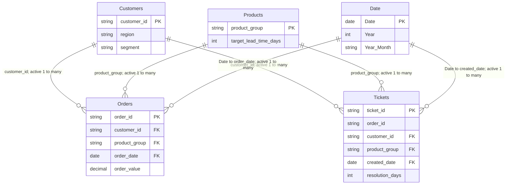

# Power Platform Operations Dashboard

[](https://github.com/hamza2829/power-platform-ops-dashboard/actions/workflows/tests.yml)

A small, explainable Microsoft Power Platform portfolio project for a **fictional furniture manufacturer's order processing and after sales team**. It prepares synthetic data, Power Query cleaning scripts, a star schema, 16 commented DAX measures, and instructions to build a three-page report in Power BI Desktop on Windows. **No Docker is needed.**

The business story: service managers want to see demand, missed delivery promises, and support workload by region and product group. East has deliberately higher delivery delays, while a fictional sofa batch produces a September 2025 ticket spike. The aim is to explain the data and KPI decisions, not to claim findings about a real company.

## What is actually built and tested?

| Component | Current status |
| --- | --- |
| Seeded Python generator, four CSVs and manifest | **Implemented and executed** with seed 42 |
| Python tests / reference checker | **28 tests passed locally and in Ubuntu CI**; [successful run](https://github.com/hamza2829/power-platform-ops-dashboard/actions/runs/40704930392) and [verification](docs/VERIFICATION.md) |
| Power Query / DAX | Commented source and definitions prepared; **not executed in Desktop yet** |
| Three-page Power BI report / PBIX | **You will build it locally**; no PBIX supplied yet |
| Screenshots | Placeholders; add your actual captures after building |
| Optional Power Automate / Power Apps | **Design documents only — not built or tested** |
| Power BI Service deployment | **Not performed** |

Code execution above was performed by Codex. No claim is made that the user has already built or tested the report themselves. Use [BUILD_STATUS.md](docs/BUILD_STATUS.md) to record your own checks, Desktop version and evidence after doing them.

## Start here

The CSVs are already included. You can go straight to [Build in Power BI Desktop in about 90 minutes](report/BUILD_IN_90_MINUTES.md), then use the [visual-by-visual specification](report/SPECIFICATION.md). Python is only needed to regenerate the data or run tests.

```text
data/          Seeded standard-library generator, four raw CSVs, issue/checksum manifest
powerquery/    Customers, Products, Orders and Tickets .pq scripts + plain explanations
dax/           CALENDAR date table, 16 measures, definitions and formatting notes
report/        Three-page spec, 90-minute guide, PBIX policy and screenshot placeholders
automation/    OPTIONAL SharePoint schema, notification flow and canvas app designs
tests/         Generator/data-contract/reference tests
tools/         Python reference totals and committed-data checker
docs/          Reference numbers, verification status and interview notes
.github/       Ubuntu test workflow
```

## Reproduce the data and run tests on Windows

Install **Python 3.12** and Git if you want to run the code; Power BI Desktop is used separately. In PowerShell:

```powershell
git clone https://github.com/hamza2829/power-platform-ops-dashboard.git
cd power-platform-ops-dashboard
py -3.12 -m venv .venv
.\.venv\Scripts\python.exe -m pip install -r requirements-dev.txt
.\.venv\Scripts\python.exe data/generate.py
.\.venv\Scripts\python.exe tools/verify_data.py
.\.venv\Scripts\python.exe -m pytest -q
.\.venv\Scripts\python.exe tools/verify_data.py --check
```

No activation or PowerShell execution-policy change is required. If `py` is unavailable but your `python` is version 3.12, use `python -m venv .venv`. The generator uses only Python's standard library; pytest is the sole direct development dependency. On Ubuntu/CI the equivalent is `python -m pip install -r requirements-dev.txt`, then the same Python commands without the Windows venv prefix.

Default seed **42**, fixed snapshot **2025-12-31**, booking window **2024-07-01 to 2025-12-31**. Files do not depend on today's date. Raw row counts include **7 appended duplicate rows**; nine additional deliberately damaged cells include missing dates, impossible chronology, an invalid date string and an invalid monetary value.

| Table | Raw CSV rows | Clean logical rows |
| --- | ---: | ---: |
| Orders | 5,003 | 5,000 |
| Customers | 801 | 800 |
| Service tickets | 1,502 | 1,500 |
| Product groups | 6 | 5 |

See [data dictionary and generation rules](data/README.md). `data/manifest.json` names every dirty ID and hashes each CSV. For a separate experiment: `python data/generate.py --seed 123 --output data-experiment`. Keep seed 42 for the committed reference dataset. Re-running the default generator overwrites its four CSVs and manifest; the reference checker detects drift.

## Data model

This is a shared-dimension star model with two facts. **Orders grain: one full order. Tickets grain: one ticket.** A product is a product group, not a SKU. The Tickets Power Query joins cleaned Orders to copy `customer_id` and `product_group`; this adds dimension keys without duplicating order revenue.



All six relationships use **single-direction filtering from the dimension (1) to the fact (*)**. There is **no Orders–Tickets model relationship**. `Tickets[order_id]` is retained for traceability, not a model foreign key to another fact. Date connects actively to Orders.order_date and Tickets.created_date; delivered/promised/closed dates are not active date roles in this beginner model. Mark `Date[Date]` as the date table and use dimension fields for shared slicers. This follows [Microsoft's star schema guidance](https://learn.microsoft.com/en-us/power-bi/guidance/star-schema).

## Cleaning and KPI decisions

Use a text parameter `DataFolder` pointing at your absolute local `data` folder. Load the four `.pq` scripts as blank queries, in the order Products, Customers, Orders, Tickets. Each script parses types explicitly, trims text and deterministically keeps the first occurrence of an ID. Explanations: [Products](powerquery/Products.md), [Customers](powerquery/Customers.md), [Orders](powerquery/Orders.md), [Tickets](powerquery/Tickets.md). Buffering before deduplication follows the documented [Table.Distinct behavior](https://learn.microsoft.com/en-us/powerquery-m/table-distinct).

- Missing actual dates remain null. Impossible dates are cleared and flagged; invalid money is null, not zero. Dimensions do not get invented event dates.
- Missing promises can be estimated from the product target, with `promise_imputed = true`. These estimates are excluded from the on-time denominator.
- Lead time and ticket resolution use **calendar days**. Open/cancelled orders are not assessable deliveries; open/invalid ticket durations do not enter resolution averages.
- **Total Revenue means non-cancelled booked order value in EUR**, not accounting revenue. Invalid order values are omitted by SUM but remain in order counts.
- **Tickets per 100 Orders is a workload ratio**: ticket creations divided by order bookings in the same selected period. It can exceed 100 because tickets may concern older orders or repeat complaints. It is not a complaint incidence rate for an order cohort.
- Date slicers exclude the deliberately undated row in each fact: unfiltered **5,000 / 1,500**, dated full window **4,999 / 1,499**. The record is retained and counted when there is no date selection.
- Open Tickets is still-open status at the fixed snapshot within selected creation dates, not historical backlog. Ticket priority filters Tickets only, so it does not change Orders measures.

## DAX measures

Create [the Date calculated table](dax/Date.dax) with CALENDAR, then add each measure from [measures.dax](dax/measures.dax) separately. [Full definitions, one-line explanations, formats and filter-context notes](dax/README.md):

| Measure | What it does and why |
| --- | --- |
| Total Revenue | Sums non-cancelled booked value to track demand in EUR. |
| Order Count | Counts all selected orders to show workload. |
| Delivered Orders | Counts delivered statuses to show completed workload. |
| Eligible Deliveries | Uses CALCULATE and FILTER to count reliable delivery comparisons. |
| Late Orders | Counts actual deliveries after an original valid promise. |
| On-Time Delivery Rate | Compares on-time with assessable deliveries, excluding unknowns. |
| Average Lead Time Days | Averages known actual delivery durations to show speed. |
| Ticket Count | Counts selected ticket creation events to show service workload. |
| Tickets per 100 Orders | Expresses ticket-event volume relative to order bookings. |
| Average Ticket Resolution Days | Averages known closed-ticket durations to show service speed. |
| Open Tickets | Shows selected tickets still open at the snapshot. |
| Revenue Previous Year | Uses SAMEPERIODLASTYEAR to retrieve the comparable prior period. |
| Revenue YoY % | Shows proportional change when both periods have data. |
| Revenue Rolling 3 Month Average | Smooths booked value over three complete calendar months. |
| Orders with Data Issues | Exposes retained orders with uncertain/invalid fields. |
| Tickets with Data Issues | Exposes retained tickets with uncertain/invalid fields. |

Only July–December 2025 has matching prior-year source months. Demonstrate YoY on those matched months, not a full 2025 versus partial 2024 comparison. The rolling measure is a three-calendar-month monthly average, not 90 days; it is blank before September 2024 and intentionally looks before a date slicer's start to complete the window.

## Report pages, screenshots and opening the report

The [report specification](report/SPECIFICATION.md) lists every visual, field, measure and slicer:

1. **Overview:** KPI cards, monthly booked-value/rolling trend, regional bar, ticket trend, data-quality cards.
2. **Delivery performance:** product-by-region on-time matrix, lead-time bar, late-order table; region drill-through from Overview lands here.
3. **After sales:** category volumes, resolution trend, priority mix, open-ticket worklist, priority/date slicers.

| Screenshot | Status / expected file |
| --- | --- |
| Overview | _Placeholder — add `report/screenshots/overview.png`_ |
| Delivery performance | _Placeholder — add `report/screenshots/delivery-performance.png`_ |
| After sales | _Placeholder — add `report/screenshots/after-sales.png`_ |

There is **no report binary yet**. Start from a blank Power BI Desktop report with [the exact build steps](report/BUILD_IN_90_MINUTES.md). After building, open `report/power-platform-ops-dashboard.pbix` in Desktop, change DataFolder if the folder moved, and refresh. Commit that exact PBIX only if **under 20 MB**. Otherwise keep it outside Git and update [the PBIX note](report/README.md) to say it is excluded due to size. Add real screenshots and update your personal verification log; do not substitute mockups.

## Tests and verification

**28 pytest cases** cover clean/raw counts and schemas, foreign keys before/after dirt, reproducible output bytes, different-seed variation, date chronology and 18-month coverage, documented dirty cases, East delivery delays, the sofa ticket spike, cleaning semantics, filters, committed artifacts and the CLI. [GitHub Actions](https://github.com/hamza2829/power-platform-ops-dashboard/actions/workflows/tests.yml) runs them on **Ubuntu / Python 3.12** for pushes and pull requests, then checks data/reference drift.

`tools/verify_data.py` implements the documented rules in Python to produce [reference_totals.json](docs/reference_totals.json). It is **not an M or DAX runtime**. With Date set to the full 18-month window and other slicers clear, seed 42 should show:

| KPI | Expected reference |
| --- | ---: |
| Order Count / Ticket Count | 4,999 / 1,499 |
| Total Revenue (booked EUR) | 11,516,357.74 |
| Delivered / eligible / late orders | 4,552 / 4,549 / 1,298 |
| On-Time Delivery Rate | 71.4663% |
| Average Lead Time Days | 29.941538 |
| Average Ticket Resolution Days | 10.244232 |

Compare within displayed rounding. Extra reference slices cover East, Sofas in September 2025, High priority, July 2025 YoY and September 2024 rolling average. **Desktop execution, model context, report visuals and drill-through require manual checking.** See [verification evidence](docs/VERIFICATION.md) and [personal build status](docs/BUILD_STATUS.md).

## Optional Power Automate and Power Apps

[automation/](automation/README.md) contains **design documents only**. The flow design uses a SharePoint item-created trigger, a High-priority condition, service email (or Teams substitution), success/failure log rows, scopes and failure run-after settings. The canvas app design includes required-field/date/order validation, an open-ticket gallery, a priority filter and a close button, with all Power Fx formulas.

These are not exported runnable solutions and have not been built/tested in a tenant. They use their own SharePoint lists and do not feed the fixed CSV report automatically. Only change their status to built after implementing, smoke-testing and recording evidence yourself.

## How I used AI and how I checked it

AI (Codex) prepared the generator, tests, M/DAX source, report instructions and optional app/flow designs. Codex executed the Python generator, ran **28 passing local tests**, verified seed-42 CSV bytes/checksums and reference totals, and confirmed **28 passing tests in Ubuntu GitHub Actions**. Formula patterns and modeling decisions were reviewed against linked Microsoft documentation. Automated tests check the Python behavior; they do not prove the M/DAX formulas or optional tenant designs run successfully.

**My personal Power BI checks are pending.** After building, record what you actually did in [BUILD_STATUS.md](docs/BUILD_STATUS.md): dirty-record inspection, model relationships, reference comparisons, slicers/drill-through and screenshots. Use [the interview notes](docs/INTERVIEW_NOTES.md) to explain the decisions in your own words. Do not claim hands-on app/flow experience from design documents or claim that AI's tests are your manual Desktop validation.

## Honest limits

- All data is synthetic; no real furniture company data, real customer PII or real business results are included.
- This is an order-level learning project, without SKUs, order lines, invoices, payments, returns accounting, working-day calendars, RLS or production data access.
- The report will be built and saved **locally in Power BI Desktop** by the user; M/DAX are supplied but not runtime-tested here. No screenshots or PBIX are fabricated.
- No Power BI Service deployment, scheduled refresh, gateway or tenant setup has been performed unless you add and document it later.
- Eighteen months limits YoY comparability. Shared Date slicers use different event dates across facts. Missing dates and omitted invalid money affect some totals transparently.
- Optional automation is unbuilt/untested design material. Notification retries may duplicate sends; no exactly-once guarantee is claimed.
