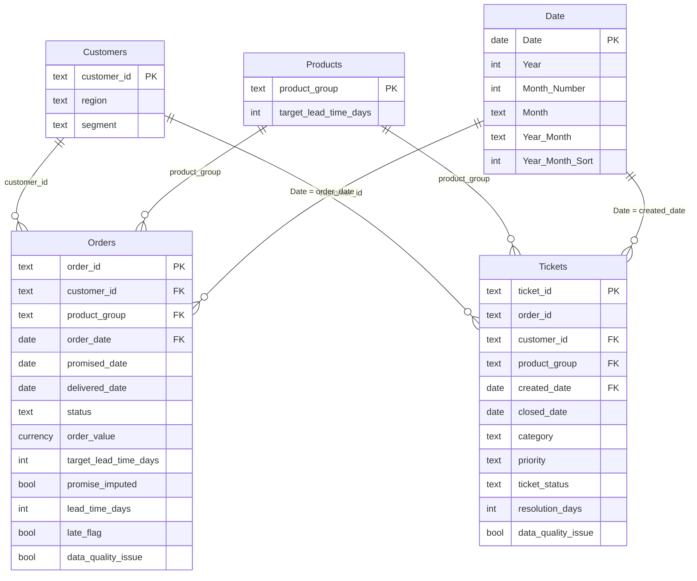

# Data model

[Wiki home](Home.md) · Sources: [Power Query scripts](../../powerquery/), [Date.dax](../../dax/Date.dax), [model notes](../../dax/README.md)

A **star schema with two fact tables** (Orders, Tickets) that share three dimensions (Customers, Products, Date). The model is specified here; it has not yet been built in a Power BI file.

In Power BI the Date columns are named with spaces (`Month Number`, `Year Month`, `Year Month Sort`); Mermaid needs underscores.

## Tables

### Customers (dimension)

- **Grain:** one customer. **Key:** `customer_id` (e.g. `CUS-0001`). **Rows:** 800.
- `region`: fictional North / South / East / West (200 customers each). `segment`: Retail / Trade / Hospitality.
- Blank region or segment would become `Unknown` (none occur in the current data).

### Products (dimension)

- **Grain:** one product **group**, not a SKU. **Key:** `product_group`. **Rows:** 5.
- `target_lead_time_days` (calendar days): Sofas 28, Kitchens 42, Dining 21, Bedroom 28, Office 14.

### Date (dimension, DAX calculated table)

- **Grain:** one day, 2023-01-01 to 2026-12-31 (1,461 rows). **Key:** `Date`.
- Mark as date table. Sort `Month` by `Month Number` and `Year Month` by `Year Month Sort`.

### Orders (fact)

- **Grain:** one whole order (no order lines). **Key:** `order_id`. **Rows:** 5,000.
- **Foreign keys:** `customer_id` → Customers, `product_group` → Products, `order_date` → Date.
- `status` as of 31 Dec 2025: Delivered 4,553 · Open 282 · Cancelled 165.
- Columns added by cleaning: `target_lead_time_days`, `promise_imputed`, `lead_time_days`, `late_flag`, `data_quality_issue`.

### Tickets (fact)

- **Grain:** one service ticket. **Key:** `ticket_id`. **Rows:** 1,500.
- **Foreign keys:** `customer_id` → Customers, `product_group` → Products, `created_date` → Date.
- `customer_id` and `product_group` are not in the raw CSV. Power Query copies them from the cleaned Orders row with the same `order_id`.
- `order_id` is kept for traceability only. It is **not** a model relationship.
- `category`: Damage / Missing parts / Assembly / Warranty. `priority`: High / Medium / Low / Unknown. `ticket_status`: Open / Closed / Unknown.

## Relationships (exactly six)

| From (one side) | To (many side) | Cardinality | Filter direction | Active |
| --- | --- | --- | --- | --- |
| `Customers[customer_id]` | `Orders[customer_id]` | 1 : * | Single | Yes |
| `Customers[customer_id]` | `Tickets[customer_id]` | 1 : * | Single | Yes |
| `Products[product_group]` | `Orders[product_group]` | 1 : * | Single | Yes |
| `Products[product_group]` | `Tickets[product_group]` | 1 : * | Single | Yes |
| `Date[Date]` | `Orders[order_date]` | 1 : * | Single | Yes |
| `Date[Date]` | `Tickets[created_date]` | 1 : * | Single | Yes |

## Rules to remember

- **No Orders–Tickets relationship.** Region and product slicers filter both facts through the shared dimensions.
- **Date means two different events:** order booking date for Orders, ticket creation date for Tickets. Promised, delivered and closed dates are not connected to Date.
- Ticket `priority` is a Tickets column, so it filters ticket measures only.
- Put shared slicers on dimension columns (`Customers[region]`, `Products[product_group]`, `Date[Date]`), never on fact columns.
